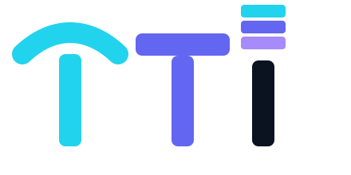

# TitanInfra

[简体中文](README.zh-CN.md) · **English** · [BSD 3-Clause](LICENSE) · Python 3.12 / PyTorch 2.15 verified

<div align="center">
  
</div>

**A full-stack LM development framework built around elastic data streams.**

We built TitanInfra to make large-model training data easier to compose, scale, and resume. We build on TorchTitan and unify Pretrain, SFT, and CPT, so you can keep your model and distributed strategy while changing text and message streams, packing, mixing, and checkpoints. Our self-developed RL mode is under development and does not yet have a public API.

## One Python example: the public API tour

We put the complete, import-safe tour in [examples/api_tour.py](examples/api_tour.py).
The calls below show how the pieces fit together. Run conversion and training
only after preparing the input paths; importing the example itself has no
training or network side effects.

```python
from titaninfra import (
    ModelConfig, TrainConfig, StreamConfig, PackStrategy, Trainer, TrainResult,
    to_hf, from_hf, download_hf_assets, compare_losses, diagnose_hf_checkpoint,
    get_template, list_templates, register_template, MoEHealthPlugin, MoEBiasSchedule,
)
from titaninfra.data.converter import DataConvertConfig, DataConverter, convert_messages_to_mds
from titaninfra.data.sft.message_converter import normalize_to_hf_messages, to_ir_messages
from examples.api_tour import MODEL_DEFAULTS, MODEL_NAMES

# Define several model families with one shared policy.
models = {name: ModelConfig(name=name, **MODEL_DEFAULTS) for name in MODEL_NAMES}

# Mixed Pretrain text + SFT messages (CPT), with 70%/30% proportions.
model = ModelConfig(name="qwen3/debugmodel", **MODEL_DEFAULTS)
train = TrainConfig(
    local_batch_size=1,
    global_batch_size=8,
    seq_len=4096,
    steps=1000,
    optimizer_name="AdamW",
    lr=3e-4,
    beta1=0.9,
    beta2=0.95,
    eps=1e-8,
    weight_decay=0.1,
    optimizer_state_dtype="fp32",
    min_lr_ratio=0.1,
    lr_decay_type="cosine",
    warmup_steps=100,
    max_grad_norm=1.0,
)
streams = [
    StreamConfig(
        local="/data/mds/general/train",
        tokenizer_name="qwen3",
        data_type="text",
        proportion=0.7,
        pack_strategy=PackStrategy.HARD_TRUNCATE,
    ),
    StreamConfig(
        local="/data/mds/sft/train",
        tokenizer_name="qwen3",
        data_type="messages",
        family="qwen3",
        proportion=0.3,
        pack_strategy=PackStrategy.FULL_SAMPLE,
    ),
]
rich_messages = [{"role": "user", "blocks": [{"type": "text", "text": "Hello"}]}]

# MDS conversion for text and rich messages.
DataConverter(DataConvertConfig(
    source="/data/raw/pretrain.jsonl", output="/data/mds/general/train",
    tokenizer_path="/models/Qwen3-8B", tokenizer_name="qwen3", num_shards=16,
)).convert()
convert_messages_to_mds(
    source="/data/raw/sft.jsonl", output="/data/mds/sft/train",
    tokenizer_path="/models/Qwen3-8B", tokenizer_name="qwen3", family="qwen3",
)

# Train after MDS and model assets are ready.
result: TrainResult = Trainer(
    model=model, train=train, streams=streams, hf_ckpt_path="/models/Qwen3-8B"
)

# Rich blocks <-> Hugging Face message dictionaries.
hf_messages, weights = normalize_to_hf_messages(rich_messages, system="Be helpful.")
rich_messages = to_ir_messages(hf_messages)

# DCP <-> Hugging Face checkpoints.
dcp_path = "/outputs/run/checkpoints/step-1000"
output_path = "/exports/qwen3-8b"
hf_path = "/models/Qwen3-8B"
to_hf(dcp_path, output_path, model_name="qwen3/8B", hf_assets_path="/models/Qwen3-8B")
dcp_output_path = "/outputs/qwen3-8b-dcp"
from_hf(hf_path, dcp_output_path, model_name="qwen3/8B")

# Assets, diagnostics, templates, and MoE monitoring.
model_dir = download_hf_assets("Qwen/Qwen3-8B", asset_types="tokenizer")
diagnose_hf_checkpoint(model_dir, verbose=True)
compare_losses(["/outputs/run-a", "/outputs/run-b"], show=False)
register_template(get_template("qwen3"))
print(list_templates())
health = MoEHealthPlugin(model_parts=[])
bias_schedule = MoEBiasSchedule(calibration_steps=100)
```

The full file also includes the exact `TrainConfig`, native `decode_sample` and
`tokenize_sample` usage, and side-effect-free `main()` for configuration checks.

## Elastic data pipeline

“Elastic” describes data composition, sequence packing, shard utilization, and resumable scaling—not automatic cluster resizing.

```text
JSONL / Parquet
      │
      ▼
DataConverter / convert_messages_to_mds
      │  MDS shards + stream_stats.json
      ▼
Per-stream StreamingDataset
      │  token-aware epoch sizing + DP-aware sharding
      ▼
Packing: hard_truncate / sentence_boundary / full_sample / no_pack
      │
      ▼
Mixing: proportion / repeat / choose
      │
      ▼
Trainer → DCP checkpoints → resume or HF export
```

| Layer | What TitanInfra provides |
|---|---|
| **Per-stream conversion** | Balanced MDS shards, exact token counts, `stream_stats.json`, and resumable conversion. |
| **Two-layer packing** | Offline shard balancing followed by runtime sequence packing with explicit document boundaries. |
| **Token-aware scheduling** | Epoch sizes and total steps use real token statistics and packing-efficiency estimates. |
| **Three mixing modes** | `proportion` for token-weighted Pretrain, `repeat` for epoch-based SFT/CPT, and `choose` for exact sample counts. |
| **DP-aware sharding** | Every data-parallel rank receives a deterministic shard; TP/CP peers share the same DP column. |
| **Remote + local streams** | MDS can stream from shared storage into per-node local caches. |
| **Checkpoint continuity** | DCP resume preserves model, optimizer, scheduler, and dataloader state without an HF round trip. |

See the [data pipeline guide](docs/en/data.md) for schemas, conversion APIs, packing constraints, and scheduling combinations.

## Custom GPU kernels

We also maintain custom GPU kernels for selected compressed-attention, vision,
and MoE operations. These paths are designed to improve performance on supported
GPUs while preserving the standard implementations for other backends. See
`titaninfra/kernels/` and the model-specific configuration before enabling an
optimized path.

## Complete recipes

Both recipes expose `build_config()` and explicitly set every required algorithm field. Importing them performs no I/O and starts no training.

| Recipe | Data and schedule | Run |
|---|---|---|
| [Pretrain](examples/pretrain.py) | Two text MDS streams, `proportion=0.7/0.3`, hard truncation, 100K steps, bf16 compute with fp32 master/state. | `python examples/pretrain.py` |
| [SFT](examples/sft.py) | Native Qwen3 message encoding, `repeat=3.0`, full-sample packing, three epochs, fp32 master/state. | `python examples/sft.py` |

Replace the neutral `/data/...`, `/models/...`, and `/outputs/...` paths first. The [training guide](docs/en/training.md) walks through data conversion, all required fields, launch, checkpoint resume, and HF export.

## Installation

The verified training environment is **Python 3.12 + PyTorch 2.15**. We develop TitanInfra on a rolling basis: `open-source` is our public development branch, so pin both its commit and the TorchTitan revision below for reproducible CPU/GPU runs. The README, recipes, and API reference in the same commit are the source of truth.

```bash
git clone https://github.com/zzhaobh/titaninfra.git
cd titaninfra
git checkout open-source

python3.12 -m venv .venv
source .venv/bin/activate
python -m pip install --upgrade pip

# Install TitanInfra's core dependencies.
python -m pip install -r requirements.txt

# Install the verified public TorchTitan runtime.
git clone https://github.com/pytorch/torchtitan.git ../torchtitan
git -C ../torchtitan checkout 692c9bb5b26f606e5fb739acd55effb6f8850bc9
python -m pip install --no-deps -e ../torchtitan

# Install MosaicML Streaming from source, avoiding its legacy Transformers<5 cap.
git clone --depth 1 https://github.com/mosaicml/streaming.git ../streaming
(cd ../streaming && git fetch --depth 1 origin 1381ca1213fc95b6573efb44e5ec9f85c765ce1c \
  && git checkout --detach FETCH_HEAD \
  && python -m pip install --no-build-isolation --no-deps .)

# Install TitanInfra without replacing the pinned engine.
python -m pip install --no-deps -e ".[data]"
python -c "from titaninfra import Trainer, ModelConfig, TrainConfig, StreamConfig; print('OK')"
```

Dependency responsibilities:

- `requirements.txt`: PyTorch 2.15, configuration/validation, Transformers, TorchData, Parquet, and the core data runtime. MosaicML Streaming is installed from source as shown above.
- `.[data]`: the matching MDS/data optional dependencies for an editable install without replacing the pinned engine.
- `requirements-dev.txt`: test, lint, packaging, and multimodal/Lance fixtures; use `.[data,dev]` for the equivalent editable-install extras.
- GPU: install the CUDA-enabled PyTorch 2.15 build appropriate for your platform, then check `python -c "import torch; print(torch.cuda.is_available())"` before training.

For development, use `python -m pip install -r requirements-dev.txt` and see the [development guide](docs/en/development.md).

## Standard Docker runtime

We provide one public [Dockerfile](Dockerfile) based on **NVIDIA CUDA 13.2 +
cuDNN on Ubuntu 24.04**, with Python 3.12, the pinned TorchTitan revision, and
the complete data dependencies. Build and verify the environment with:

```bash
docker build -t titaninfra:rolling .
docker run --rm -it titaninfra:rolling \
  python -c "from titaninfra import Trainer, ModelConfig; print('OK')"
```

For GPU training, install NVIDIA Container Toolkit on the host and run:

```bash
docker run --rm --gpus all -it \
  -v /data:/data -v /models:/models -v /outputs:/outputs \
  titaninfra:rolling
```

The container uses `/workspace` for the source tree and `/opt/torchtitan` for the
pinned engine. Mount your own datasets, model assets, and output directories;
they are not copied into the image. On Apple Silicon, add
`--platform=linux/amd64` to `docker build` and `docker run` because NVIDIA's
CUDA/cuDNN images target amd64.

### Full upstream GPU environment

For the complete upstream dependency stack, use
[docker/titaninfra-full.Dockerfile](docker/titaninfra-full.Dockerfile). It keeps
the full CUDA 13.2.1/cuDNN environment: PyTorch 2.15, DeepEP, FlashMLA, vLLM,
MosaicML Streaming, multimodal libraries, profiling tools, and runtime checks.
The root `Dockerfile` remains the smaller standard environment.

```bash
docker build -f docker/titaninfra-full.Dockerfile -t titaninfra:full .
docker run --rm --gpus all -it \
  -v "$PWD:/workspace" -v /data:/data -v /models:/models -v /outputs:/outputs \
  titaninfra:full
```

Mount the source checkout and model/data assets at runtime; they are not copied
into the image. No prebuilt image is published by this repository.

## MDS and Message conversion APIs

Pretrain text conversion:

```python
from titaninfra.data.converter import DataConvertConfig, DataConverter

config = DataConvertConfig(
    source="/data/raw/pretrain.jsonl",
    output="/data/mds/general/train",
    tokenizer_path="/models/Qwen3-8B",
    tokenizer_name="qwen3",
    text_key="text",
    num_shards=16,
)
DataConverter(config).convert()
```

SFT message conversion uses the same native encoder as training, so token counts and runtime loss masks share one implementation:

```python
from titaninfra.data.converter import convert_messages_to_mds

convert_messages_to_mds(
    source="/data/raw/sft.jsonl",
    output="/data/mds/sft/train",
    tokenizer_path="/models/Qwen3-8B",
    tokenizer_name="qwen3",
    family="qwen3",
    num_shards=16,
    overwrite=True,
)
```

### Message structure conversion

**Our Message system is built for training, not just chat formatting.** Native
family encoders, loss masks, history policy, token statistics, and packing share
one contract from raw messages to the training engine.

Convert rich TitanInfra blocks to Hugging Face messages, or back to the rich IR,
without tokenizing or writing MDS:

```python
from titaninfra.data.sft.message_converter import (
    normalize_to_hf_messages,
    to_ir_messages,
)

hf_messages, weights = normalize_to_hf_messages(
    rich_messages,
    system="You are a helpful assistant.",
)
rich_messages = to_ir_messages(hf_messages)
```

`normalize_to_hf_messages` returns `(hf_messages, weights)` and preserves tool
calls/results and reasoning fields. `to_ir_messages` restores TitanInfra
`blocks`. The resulting messages can be passed to `convert_messages_to_mds` or
`tokenize_sample`.

See the complete [MDS/message API reference](docs/en/api.md#mds-conversion-apis)
and [Message system guide](docs/en/data.md#message-system-schema) for schemas,
loss weights, history policy, tools, images, validation, and end-to-end usage.

## Public API

```python
from titaninfra import (
    ModelConfig, TrainConfig, StreamConfig, PackStrategy,
    Trainer, TrainResult,
    to_hf, from_hf,
    download_hf_assets, compare_losses, diagnose_hf_checkpoint,
    get_template, list_templates, register_template,
    MoEHealthPlugin, MoEBiasSchedule,
)
```

`ModelConfig`, `TrainConfig`, and `StreamConfig` deliberately make algorithm-defining fields explicit. This prevents a recipe from silently depending on hidden optimizer, precision, attention, or warmup defaults. See the [API reference](docs/en/api.md).

## Current scope and future direction

- **Available:** Pretrain, SFT, CPT, text/message streams, MDS conversion, DCP/HF conversion, FSDP2/TP/CP/EP configurations, monitoring, and checkpoint resume.
- **Model registry:** Qwen3, Qwen2.5, Llama3, DeepSeek V3/V4, GPT-OSS, Gemma4, Qwen3.5, and Kimi-VL configurations, with TorchTitan fallback for additional families.
- **Not in this release:** Pipeline Parallelism is outside the current supported scope. A **self-developed RL** mode is under development; its API, engine, and recipes will be published when they are ready.

## Documentation

- [API reference](docs/en/api.md)
- [Configuration reference](docs/en/config.md)
- [Data pipeline and formats](docs/en/data.md)
- [Training and complete recipes](docs/en/training.md)
- [Development and testing](docs/en/development.md)
- [Contribution guide](CONTRIBUTING.md)
- [Third-party notices](THIRD_PARTY_NOTICES.md)

## Citation

If TitanInfra contributes to your research or production work, please cite it:

```bibtex
@software{titaninfra2026,
  title  = {TitanInfra: Elastic Data Pipelines and Training Recipes},
  author = {TitanInfra Contributors},
  year   = {2026},
  url    = {https://github.com/zzhaobh/titaninfra},
  license = {BSD-3-Clause}
}
```

## License

TitanInfra is released under the [BSD 3-Clause License](LICENSE), matching TorchTitan. Derived third-party code retains its original notices; see [THIRD_PARTY_NOTICES.md](THIRD_PARTY_NOTICES.md).
