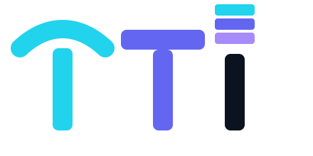

# TitanInfra

**简体中文** · [English](README.md) · [BSD 3-Clause](LICENSE) · 已验证 Python 3.12 / PyTorch 2.15

<div align="center">
  
</div>

**以弹性数据流为核心的全栈 LM 模型开发框架。**

我们做 TitanInfra，是为了让大模型训练数据更容易组合、扩展和恢复。我们基于 TorchTitan 统一 Pretrain、SFT 和 CPT，让你可以保留模型与分布式策略，灵活调整文本流、消息流、packing、混合方式和 checkpoint。我们的自研 RL 模式仍在开发中，目前尚未提供公开 API。

## 项目目标

我们要把 TitanInfra 从零构建成一个完整的 LLM 训练框架，而不是微调工具的
薄封装。我们以 TorchTitan 作为分布式运行时，目标是让用户从**随机初始化
预训练（from-scratch pretraining）**开始，在同一套编程模型中完成 SFT 和 CPT。

| 目标领域 | 我们提供的能力 |
|---|---|
| **分布式数据调度** | DP 感知分片、token-aware epoch/step sizing、`proportion`/`repeat`/`choose` 混合、packing 和确定性恢复。 |
| **数据策略** | MDS 转换、精确 token 统计、两层 packing、history/turn 策略、优化器与 LR 调度、精度控制。 |
| **后训练 Message 系统** | 原生 family encoder、rich message blocks、loss mask、thinking/effort、tools、history，以及 Pretrain+SFT 混合流。 |
| **MoE 与参数可视化** | Expert 利用率、不均衡/dead-expert 检测、expert-bias 生命周期和 MoE 健康指标。 |
| **模型参数与计算统计** | 参数量/FLOP 估算、通过奇异值熵观察参数分布变化、MFU/profiling 和算子归因。 |

完整链路是 **数据准备 → 模型定义 → 分布式执行 → checkpoint/export →
监控与诊断**。下面的章节会用具体 API 和 recipe 展示这些能力，而不是把它们
拆成彼此独立的产品。

## 一个 Python 示例看遍公开 API

我们把完整、可安全导入的示例放在 [examples/api_tour.py](examples/api_tour.py)。
下面的调用展示各组件如何配合。请先准备好输入路径，再执行转换和训练；
仅导入示例不会启动训练或访问网络。

```python
from titaninfra import (
    ModelConfig, TrainConfig, StreamConfig, PackStrategy, Trainer, TrainResult,
    to_hf, from_hf, download_hf_assets, compare_losses, diagnose_hf_checkpoint,
    get_template, list_templates, register_template, MoEHealthPlugin, MoEBiasSchedule,
)
from titaninfra.data.converter import DataConvertConfig, DataConverter, convert_messages_to_mds
from titaninfra.data.sft.message_converter import normalize_to_hf_messages, to_ir_messages
from examples.api_tour import MODEL_DEFAULTS, MODEL_NAMES

# 用同一套策略定义多个模型家族。
models = {name: ModelConfig(name=name, **MODEL_DEFAULTS) for name in MODEL_NAMES}

# 混合 Pretrain 文本流 + SFT 消息流（CPT），比例 70%/30%。
model = ModelConfig(name="qwen3/debugmodel", **MODEL_DEFAULTS)
train = TrainConfig(
    local_batch_size=1,
    global_batch_size=8,
    seq_len=4096,
    steps=1000,
    optimizer_name="AdamW",
    lr=3e-4,
    beta1=0.9,
    beta2=0.95,
    eps=1e-8,
    weight_decay=0.1,
    optimizer_state_dtype="fp32",
    min_lr_ratio=0.1,
    lr_decay_type="cosine",
    warmup_steps=100,
    max_grad_norm=1.0,
)
streams = [
    StreamConfig(
        local="/data/mds/general/train",
        tokenizer_name="qwen3",
        data_type="text",
        proportion=0.7,
        pack_strategy=PackStrategy.HARD_TRUNCATE,
    ),
    StreamConfig(
        local="/data/mds/sft/train",
        tokenizer_name="qwen3",
        data_type="messages",
        family="qwen3",
        proportion=0.3,
        pack_strategy=PackStrategy.FULL_SAMPLE,
    ),
]
rich_messages = [{"role": "user", "blocks": [{"type": "text", "text": "Hello"}]}]

# 文本与 rich message 的 MDS 转换。
DataConverter(DataConvertConfig(
    source="/data/raw/pretrain.jsonl", output="/data/mds/general/train",
    tokenizer_path="/models/Qwen3-8B", tokenizer_name="qwen3", num_shards=16,
)).convert()
convert_messages_to_mds(
    source="/data/raw/sft.jsonl", output="/data/mds/sft/train",
    tokenizer_path="/models/Qwen3-8B", tokenizer_name="qwen3", family="qwen3",
)

# MDS 和模型资产准备好之后再训练。
result: TrainResult = Trainer(
    model=model, train=train, streams=streams, hf_ckpt_path="/models/Qwen3-8B"
)

# Rich blocks <-> Hugging Face messages。
hf_messages, weights = normalize_to_hf_messages(rich_messages, system="Be helpful.")
rich_messages = to_ir_messages(hf_messages)

# DCP <-> Hugging Face checkpoint。
dcp_path = "/outputs/run/checkpoints/step-1000"
output_path = "/exports/qwen3-8b"
hf_path = "/models/Qwen3-8B"
to_hf(dcp_path, output_path, model_name="qwen3/8B", hf_assets_path="/models/Qwen3-8B")
dcp_output_path = "/outputs/qwen3-8b-dcp"
from_hf(hf_path, dcp_output_path, model_name="qwen3/8B")

# 模型资产、诊断、模板和 MoE 监控。
model_dir = download_hf_assets("Qwen/Qwen3-8B", asset_types="tokenizer")
diagnose_hf_checkpoint(model_dir, verbose=True)
compare_losses(["/outputs/run-a", "/outputs/run-b"], show=False)
register_template(get_template("qwen3"))
print(list_templates())
health = MoEHealthPlugin(model_parts=[])
bias_schedule = MoEBiasSchedule(calibration_steps=100)
```

完整文件还包含精确的 `TrainConfig`、原生 `decode_sample` 和
`tokenize_sample` 用法，以及无副作用的 `main()` 配置检查。

## 弹性数据管道

这里的“弹性”指数据组合、序列打包、分片利用率和可恢复的扩展能力，不是自动增减集群节点。

```text
JSONL / Parquet
      │
      ▼
DataConverter / convert_messages_to_mds
      │  MDS 分片 + stream_stats.json
      ▼
每个流独立的 StreamingDataset
      │  基于 token 的 epoch 估算 + DP 感知分片
      ▼
打包：hard_truncate / sentence_boundary / full_sample / no_pack
      │
      ▼
混合：proportion / repeat / choose
      │
      ▼
Trainer → DCP checkpoint → 恢复训练或导出 HF
```

| 层级 | TitanInfra 提供的能力 |
|---|---|
| **逐流转换** | 均衡 MDS 分片、精确 token 统计、`stream_stats.json` 和可恢复转换。 |
| **两层打包** | 离线 shard 均衡与运行时序列打包分层处理，显式保留文档边界。 |
| **基于 token 的调度** | 使用真实 token 统计与 packing 效率估算 epoch size 和总步数。 |
| **三种混合模式** | `proportion` 用于按 token 比例预训练，`repeat` 用于按轮次 SFT/CPT，`choose` 用于精确样本数。 |
| **DP 感知分片** | 每个数据并行 rank 获得确定性分片，TP/CP 同行共享同一 DP 数据列。 |
| **远程 + 本地流** | MDS 可从共享存储流式进入每个节点的本地缓存。 |
| **Checkpoint 连续性** | DCP 恢复保留模型、优化器、调度器和 dataloader 状态，无需经过 HF 往返转换。 |

数据 schema、转换 API、packing 限制与调度组合见[数据管道指南](docs/zh-CN/data.md)。

## 仓库模块地图

我们以数据流为中心组织仓库。先看这张地图，就能快速找到入口，不必从
整个源码树开始阅读。

| 模块 | 作用 | 主要入口 |
|---|---|---|
| **配置系统** | Pydantic 模型、训练和流配置，算法字段显式声明。 | `titaninfra/config/`、[配置参考](docs/zh-CN/config.md) |
| **MDS 转换** | 将 JSONL/Parquet 转为均衡 MDS shard 和精确 `stream_stats.json`。 | `titaninfra/data/converter.py`、`recompute_stats.py`、[转换 API](docs/zh-CN/api.md#mds-格式转换-api) |
| **运行时数据管道** | MDS 加载、token-aware epoch sizing、packing、混合和 DP 感知分片。 | `streaming_dataset.py`、`packer.py`、`token_estimator.py` |
| **Message 系统** | 训练原生 rich blocks、loss mask、history policy、thinking/effort、tools 和 HF/IR 转换。 | `data/schema.py`、`sft/dispatch.py`、`sft/message_converter.py`、[Message 完整规范](docs/zh-CN/message-system.md) |
| **多模态数据** | Lance/图像解码、patch/token 估算、decode pool 和多模态 collate。 | `titaninfra/data/multimodal/` |
| **训练引擎** | Pretrain、SFT、CPT 共用一套模型、优化器、checkpoint 和 data-loader 装配。 | `titaninfra/trainer.py`、`engine/pretrain.py`、`engine/train_step.py` |
| **模型注册** | 家族配置、attention/model 实现、sharding 和 HF/DCP adapter。 | `titaninfra/models/`、`engine/pretrain.py::_load_model_spec` |
| **分布式运行时** | FSDP2/HSDP、TP/CP/EP 声明、编译和上游兼容层。 | `titaninfra/distributed/` |
| **自研 kernels** | 可选 GPU kernel，提供注册、接入、parity 校验和回退路径。 | `titaninfra/kernels/` |
| **优化器** | Muon、Muon+AdamW 混合优化器、参数组和 QK-Clip。 | `titaninfra/optimizers/` |
| **监控** | MoE 健康度、辅助负载均衡和奇异值熵。 | `titaninfra/monitoring/` |
| **Profiling** | torch.profiler、trace 分析和算子效率归因。 | `titaninfra/profiling/` |
| **Checkpoint 转换** | 通过家族 state-dict adapter 在 DCP 与 HF safetensors 之间转换。 | `titaninfra/convert.py` |
| **工具** | 资产下载、HF 诊断、loss 对比和训练检查。 | `titaninfra/tools/` |
| **通用工具** | resume、WandB、metrics plugin 和 NEFTune。 | `titaninfra/utils/` |
| **示例与脚本** | API tour、Pretrain/SFT recipe、转换、检查和启动工具。 | `examples/`、`scripts/` |
| **测试与 fixture** | CPU/GPU 回归、原生 encoder oracle、调度和 release 检查。 | `tests/`、[开发指南](docs/zh-CN/development.md) |

### 模型家族

下表用于导航，不表示每个家族的所有并行/kernel 组合都已验证。具体能力
以对应配置和测试为准。

| 家族 | 架构与典型用途 |
|---|---|
| **Qwen3** | Dense 和 MoE GQA，支持原生 Qwen3 messages 与 thinking/history。 |
| **Qwen2.5** | 带 QKV bias 的 Dense GQA，支持 FSDP2 和原生 messages。 |
| **Llama3** | Dense GQA、position-aware 文档 mask 和原生 messages。 |
| **DeepSeek V3** | MLA + MoE、分组路由、shared experts，以及 Kimi/Moonlight 变体。 |
| **DeepSeek V4** | CSA/HCA 压缩注意力、MoE、MTP/hyper-connections 和自研 gather kernels。 |
| **GPT-OSS** | Attention-sink 与 MoE 变体、Harmony/native messages 和 reasoning effort。 |
| **Gemma4** | Sliding/full 混合注意力、并行 MLP+MoE、GELU experts 和 weight tying。 |
| **Qwen3.5** | GatedDeltaNet/full-attention 混合 decoder、vision encoder、MRoPE 和多模态训练。 |
| **Kimi-VL** | MoonViT 视觉塔 + projector + DeepSeek-V3 语言塔。 |
| **TorchTitan fallback** | TitanInfra 未提供原生 registry 时接入 Llama4 等其他家族。 |

## 自研 GPU kernels

项目还包含自研 GPU kernels，用于压缩注意力、视觉和 MoE 等特定计算路径，
在支持的 GPU 上优化性能；其他后端继续使用标准实现。启用优化路径前，请查看
`titaninfra/kernels/` 和对应模型的配置说明。

## 完整 recipe

两个 recipe 都提供 `build_config()`，并显式写出全部必填算法字段。导入它们不会读取数据，也不会启动训练。

| Recipe | 数据与调度 | 运行 |
|---|---|---|
| [Pretrain](examples/pretrain.py) | 两路文本 MDS，`proportion=0.7/0.3`，硬截断，100K steps，bf16 计算 + fp32 master/state。 | `python examples/pretrain.py` |
| [SFT](examples/sft.py) | Qwen3 原生消息编码，`repeat=3.0`，完整样本 packing，三轮训练，fp32 master/state。 | `python examples/sft.py` |

运行前请替换中性的 `/data/...`、`/models/...` 和 `/outputs/...` 路径。[训练指南](docs/zh-CN/training.md) 逐步说明数据转换、全部必填字段、启动、checkpoint 恢复与 HF 导出。

## 安装

已验证的训练环境是 **Python 3.12 + PyTorch 2.15**。我们采用滚动开发方式：`open-source` 是公开开发分支，因此要在 CPU/GPU 上复现结果，请同时固定该分支的 commit 和下面的 TorchTitan revision。同一 commit 中的 README、recipe 和 API 文档就是接口依据。

```bash
git clone https://github.com/zzhaobh/titaninfra.git
cd titaninfra
git checkout open-source

python3.12 -m venv .venv
source .venv/bin/activate
python -m pip install --upgrade pip

# 安装 TitanInfra 核心依赖。
python -m pip install -r requirements.txt

# 安装已验证的公开 TorchTitan 运行时。
git clone https://github.com/pytorch/torchtitan.git ../torchtitan
git -C ../torchtitan checkout 692c9bb5b26f606e5fb739acd55effb6f8850bc9
python -m pip install --no-deps -e ../torchtitan

# 从源码安装 MosaicML Streaming，避开旧版 Transformers<5 元数据限制。
git clone --depth 1 https://github.com/mosaicml/streaming.git ../streaming
(cd ../streaming && git fetch --depth 1 origin 1381ca1213fc95b6573efb44e5ec9f85c765ce1c \
  && git checkout --detach FETCH_HEAD \
  && python -m pip install --no-build-isolation --no-deps .)

# 安装 TitanInfra，同时避免替换固定引擎。
python -m pip install --no-deps -e ".[data]"
python -c "from titaninfra import Trainer, ModelConfig, TrainConfig, StreamConfig; print('OK')"
```

依赖分工如下：

- `requirements.txt`：PyTorch 2.15、配置校验、Transformers、TorchData、Parquet 和核心数据运行时。MosaicML Streaming 按上面的步骤从源码安装。
- `.[data]`：与可编辑安装匹配的 MDS/数据可选依赖，不会替换固定版本的引擎。
- `requirements-dev.txt`：测试、lint、构建和多模态/Lance fixture；对应的可编辑安装 extras 为 `.[data,dev]`。
- GPU：请安装适合当前平台的 CUDA 版 PyTorch 2.15，训练前执行 `python -c "import torch; print(torch.cuda.is_available())"` 检查。

开发环境请运行 `python -m pip install -r requirements-dev.txt`，并阅读[开发指南](docs/zh-CN/development.md)。

## 标准 Docker 运行环境

仓库只保留一份公开 [Dockerfile](Dockerfile)，基于 **NVIDIA CUDA 13.2 +
cuDNN / Ubuntu 24.04**，包含 Python 3.12、固定 TorchTitan revision 和完整
数据依赖。构建并检查运行环境：

```bash
docker build -t titaninfra:rolling .
docker run --rm -it titaninfra:rolling \
  python -c "from titaninfra import Trainer, ModelConfig; print('OK')"
```

GPU 训练需要宿主机安装 NVIDIA Container Toolkit，然后运行：

```bash
docker run --rm --gpus all -it \
  -v /data:/data -v /models:/models -v /outputs:/outputs \
  titaninfra:rolling
```

容器中的源码位于 `/workspace`，固定引擎位于 `/opt/torchtitan`。数据集、模型
资产和输出目录由你自行挂载，不会复制进镜像。Apple Silicon 上请在
`docker build` 和 `docker run` 时加上 `--platform=linux/amd64`，因为 NVIDIA
CUDA/cuDNN 镜像面向 amd64。

### 完整上游 GPU 环境

完整的上游依赖栈见
[docker/titaninfra-full.Dockerfile](docker/titaninfra-full.Dockerfile)。其中保留
CUDA 13.2.1/cuDNN、PyTorch 2.15、DeepEP、FlashMLA、vLLM、MosaicML Streaming、
多模态依赖、profiling 工具和运行时检查。根目录 `Dockerfile` 仍是精简标准环境。

```bash
docker build -f docker/titaninfra-full.Dockerfile -t titaninfra:full .
docker run --rm --gpus all -it \
  -v "$PWD:/workspace" -v /data:/data -v /models:/models -v /outputs:/outputs \
  titaninfra:full
```

源码、模型和数据资产在运行时挂载，不复制进镜像；仓库不发布预构建镜像。

## MDS 与 Message 格式转换 API

预训练文本转换：

```python
from titaninfra.data.converter import DataConvertConfig, DataConverter

config = DataConvertConfig(
    source="/data/raw/pretrain.jsonl",
    output="/data/mds/general/train",
    tokenizer_path="/models/Qwen3-8B",
    tokenizer_name="qwen3",
    text_key="text",
    num_shards=16,
)
DataConverter(config).convert()
```

SFT 消息转换与训练使用同一个原生 encoder，因此 token 统计和运行时 loss mask 共享同一实现：

```python
from titaninfra.data.converter import convert_messages_to_mds

convert_messages_to_mds(
    source="/data/raw/sft.jsonl",
    output="/data/mds/sft/train",
    tokenizer_path="/models/Qwen3-8B",
    tokenizer_name="qwen3",
    family="qwen3",
    num_shards=16,
    overwrite=True,
)
```

### Message 结构转换

**我们的 Message 系统是为训练而生的，而不只是聊天格式工具。** 从原始消息到
训练引擎，原生 family encoder、loss mask、history policy、token 统计和
packing 共用同一套契约。

在不 tokenize、不写 MDS 的情况下，将 TitanInfra rich blocks 转为 HF
messages，或转回 rich IR：

```python
from titaninfra.data.sft.message_converter import (
    normalize_to_hf_messages,
    to_ir_messages,
)

hf_messages, weights = normalize_to_hf_messages(
    rich_messages,
    system="You are a helpful assistant.",
)
rich_messages = to_ir_messages(hf_messages)
```

`normalize_to_hf_messages` 返回 `(hf_messages, weights)`，并保留 tool
call/result 和推理字段；`to_ir_messages` 还原为 TitanInfra `blocks`。转换后的
messages 可交给 `convert_messages_to_mds` 或 `tokenize_sample`。

完整的 [MDS/Message API 参考](docs/zh-CN/api.md#mds-格式转换-api)和
[Message 系统指南](docs/zh-CN/data.md#message-系统-schema)包含 schema、loss
weight、history policy、tools、image、校验和端到端用法。

## 公开 API

```python
from titaninfra import (
    ModelConfig, TrainConfig, StreamConfig, PackStrategy,
    Trainer, TrainResult,
    to_hf, from_hf,
    download_hf_assets, compare_losses, diagnose_hf_checkpoint,
    get_template, list_templates, register_template,
    MoEHealthPlugin, MoEBiasSchedule,
)
```

`ModelConfig`、`TrainConfig` 和 `StreamConfig` 刻意要求显式写出算法相关字段，避免 recipe 静默依赖隐藏的优化器、精度、attention 或 warmup 默认值。详见 [API 参考](docs/zh-CN/api.md)。

## 当前范围与未来方向

- **当前可用：** Pretrain、SFT、CPT、文本/消息流、MDS 转换、DCP/HF 转换、FSDP2/TP/CP/EP 配置、监控和 checkpoint 恢复。
- **模型注册：** Qwen3、Qwen2.5、Llama3、DeepSeek V3/V4、GPT-OSS、Gemma4、Qwen3.5 和 Kimi-VL 配置；其他家族可通过 TorchTitan fallback 接入。
- **当前不包含：** Pipeline Parallelism 不在当前支持范围内。**self-developed RL** 模式仍在开发中，其 API、引擎和 recipe 将在成熟后开放，当前仅保留扩展位置。

## 文档

- [架构指南（英文）](docs/en/architecture.md)
- [研究与设计动机（英文）](docs/en/research.md)
- [API 参考](docs/zh-CN/api.md)
- [配置参考](docs/zh-CN/config.md)
- [Message 系统完整规范](docs/zh-CN/message-system.md)
- [数据管道与格式](docs/zh-CN/data.md)
- [训练与完整 recipe](docs/zh-CN/training.md)
- [开发与测试](docs/zh-CN/development.md)
- [贡献指南](CONTRIBUTING.md)
- [第三方声明](THIRD_PARTY_NOTICES.md)

## 引用

如果 TitanInfra 用于你的研究或生产工作，请使用以下 BibTeX 引用：

```bibtex
@software{titaninfra2026,
  title  = {TitanInfra: Elastic Data Pipelines and Training Recipes},
  author = {TitanInfra Contributors},
  year   = {2026},
  url    = {https://github.com/zzhaobh/titaninfra},
  license = {BSD-3-Clause}
}
```

## 许可证

TitanInfra 使用与 TorchTitan 一致的 [BSD 3-Clause License](LICENSE)。派生第三方代码保留原始声明，详见 [THIRD_PARTY_NOTICES.md](THIRD_PARTY_NOTICES.md)。
